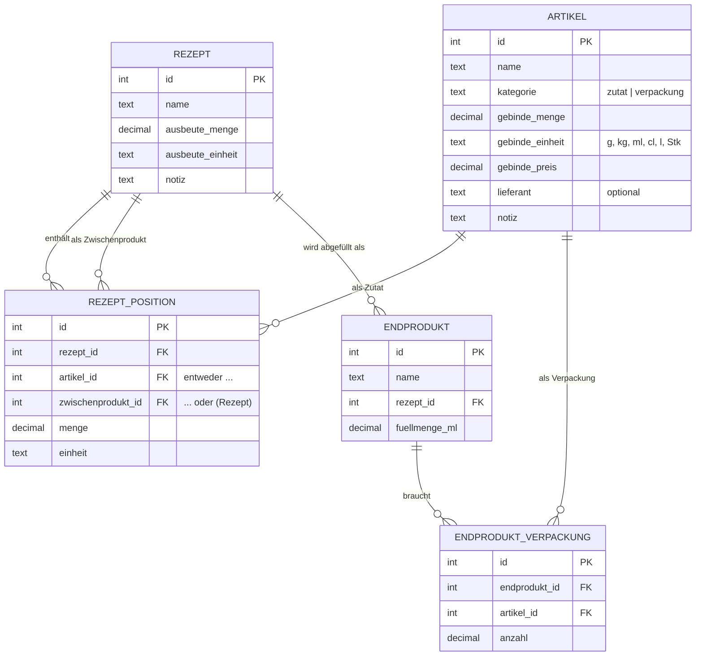

# Planung: Herstellkosten-Kalkulator (Sirup, Likör & Co.)

> Stand: 11.11.2026 – reine Planung, noch keine Umsetzung

---

## 1. Ziel

Ein lokales Tool, mit dem sich die **Herstellkosten pro Gebinde eines fertigen Produkts** grob berechnen lassen.

- Zutaten und Verpackungen werden mit ihrem **Einkaufs-Gebindepreis** erfasst (z. B. „10 kg Orangen für 15,00 €“).
- Das Tool bricht diesen Preis auf eine **Basiseinheit** herunter (€/g, €/ml, €/Stk).
- Über **Rezepte** (Zutaten + Mengen + Ausbeute) wird der Preis pro Liter bzw. Kilogramm des Produkts ermittelt.
- Über **Endprodukte** (Füllmenge + Verpackung) ergibt sich der Preis pro fertiger Flasche/Glas.

## 2. Rahmenbedingungen

| Thema | Entscheidung |
|---|---|
| Nutzung | Einzelplatz, nur am eigenen PC, kein Login |
| Betriebssysteme | **Windows und Linux** |
| Umfang | Start mit ca. 10 Zutaten und ca. 10 Rezepten, Rezepte sollen sich ansammeln können |
| Kostenumfang | **Nur Material:** Zutaten + Verpackung |
| Nicht enthalten | Arbeitszeit, Energie, Alkoholsteuer, Marge, MwSt., Verkaufspreis |
| Genauigkeit | Grobe Kalkulation, Anzeige auf Cent gerundet |

## 3. Begriffe

| Begriff | Bedeutung | Beispiel |
|---|---|---|
| **Einkaufsartikel** | Etwas, das gekauft wird – entweder *Zutat* oder *Verpackung* | Orangen, Zucker, Alkohol 96 %, Flasche 0,5 l |
| **Gebinde (Einkauf)** | Die Menge, in der ein Artikel gekauft wird | 10 kg Netz, 1 l Flasche, 100 Stk Karton |
| **Basiseinheit** | Interne Recheneinheit | g (Masse), ml (Volumen), Stk (Stück) |
| **Rezept** | Eine Charge: Liste von Zutaten mit Mengen + Ausbeute | Orangensirup |
| **Ausbeute** | Wie viel fertiges Produkt eine Charge ergibt | 2 l Sirup |
| **Zwischenprodukt** | Ein Rezept, das als Zutat in einem anderen Rezept verwendet wird | Sirup im Likör |
| **Endprodukt** | Rezept + Füllmenge + Verpackung = verkaufsfertiges Gebinde | Orangenlikör 0,5 l Flasche |

## 4. Funktionsumfang

### 4.1 Muss (Version 1)

1. **Einkaufsartikel verwalten** (anlegen, bearbeiten, löschen)
   - Name, Kategorie (Zutat / Verpackung), Gebindegröße, Einheit, Gebindepreis
   - Optional: Lieferant (nur zur Info, kein Einfluss auf die Rechnung)
   - Anzeige des berechneten Preises pro Basiseinheit (und zur Lesbarkeit pro kg / l / Stk)
2. **Rezepte verwalten**
   - Name, Ausbeute (Menge + Einheit, unabhängig von den Einheiten der Zutaten), optionale Notiz
   - Positionen: Einkaufsartikel **oder** anderes Rezept (Zwischenprodukt) + Menge + Einheit
   - Live-Anzeige: Kosten je Position, Gesamtkosten der Charge, Kosten pro l bzw. kg
3. **Endprodukte verwalten**
   - Name, zugehöriges Rezept, Füllmenge **in ml**
   - Nur Rezepte mit Ausbeute in Volumen (ml/cl/l) sind auswählbar
   - Verpackungspositionen (Artikel + Anzahl pro Gebinde, meist 1)
   - Anzeige: Inhaltskosten + Verpackungskosten = **Herstellkosten pro Gebinde**
4. **Übersicht**
   - Tabelle aller Endprodukte mit Herstellkosten pro Gebinde
5. **Automatische Neuberechnung**
   - Preise werden nie gespeichert, sondern immer live berechnet → Preisänderung bei einer Zutat wirkt sofort auf alle Rezepte und Endprodukte.

### 4.2 Kann (später)

- Export der Übersicht als CSV/Excel oder PDF
- Hochrechnung: „Ich will 20 Flaschen machen“ → benötigte Mengen / Einkaufsliste
- Rezept duplizieren (für Varianten)
- Umrechnung Masse ↔ Volumen über Dichte (z. B. Zucker in ml)

## 5. Rechenlogik

### 5.1 Einheiten

Es gibt drei Einheitengruppen. Umgerechnet wird **nur innerhalb einer Gruppe**:

| Gruppe | Basiseinheit | Erlaubte Eingabeeinheiten |
|---|---|---|
| Masse | g | g, kg |
| Volumen | ml | ml, cl, l |
| Stück | Stk | Stk |

Wird im Rezept eine Einheit aus einer anderen Gruppe als beim Einkauf verwendet (z. B. Zucker in kg gekauft, im Rezept in ml), gibt das Tool einen **Fehler/Hinweis** aus statt still falsch zu rechnen.

### 5.2 Formeln

**Preis pro Basiseinheit eines Einkaufsartikels**

$$
p_{\text{Artikel}} = \frac{\text{Gebindepreis}}{\text{Gebindegröße in Basiseinheit}}
$$

**Kosten einer Rezept-Charge**

$$
K_{\text{Charge}} = \sum_{i} \text{Menge}_i \cdot p_i
$$

wobei $p_i$ entweder der Preis eines Einkaufsartikels oder der Preis eines Zwischenprodukts ist.

**Preis pro Basiseinheit eines Rezepts**

$$
p_{\text{Rezept}} = \frac{K_{\text{Charge}}}{\text{Ausbeute in Basiseinheit}}
$$

**Herstellkosten pro Endgebinde**

$$
K_{\text{Gebinde}} = \text{Füllmenge} \cdot p_{\text{Rezept}} + \sum_{j} \text{Anzahl}_j \cdot p_{\text{Verpackung},j}
$$

### 5.3 Regeln

- **Ausbeute wird manuell eingegeben**, weil sie wegen Verdunstung, Schalen, Trester usw. selten der Summe der Zutaten entspricht. Wenn alle Zutaten in derselben Einheitengruppe wie die Ausbeute vorliegen, wird die Summe der Zutatenmengen als Vorschlag angezeigt.
- **Einheitenwechsel über Zwischenprodukte:** Die Ausbeute-Einheit eines Rezepts darf eine andere Gruppe haben als die Zutaten. So können z. B. Orangen in Stück gekauft, zu Saft verarbeitet und danach in ml weitergerechnet werden (siehe 5.5). Eine Umrechnung Stück ↔ Gramm ist dafür nicht nötig.
- **Endprodukte werden immer in ml abgefüllt.** Das zugehörige Rezept muss deshalb eine Ausbeute in Volumen haben.
- **Zwischenprodukte** werden rekursiv berechnet. Zirkelbezüge (Rezept A enthält B, B enthält A) werden beim Speichern erkannt und verhindert.
- **Kostenlose Zutaten** (z. B. Leitungswasser) können als Artikel mit Preis 0 angelegt werden, damit sie im Rezept sichtbar bleiben.
- **Rundung:** Intern wird ohne Rundung gerechnet (Python `Decimal`), gerundet wird nur bei der Anzeige:
  - Geldbeträge: 2 Nachkommastellen
  - Preis pro Basiseinheit: 4 Nachkommastellen (bzw. Anzeige pro kg / l mit 2 Nachkommastellen)
- **Löschen:** Ein Artikel oder Rezept, das noch verwendet wird, kann nicht gelöscht werden. Das Tool zeigt an, wo es verwendet wird.

### 5.4 Beispielrechnung (dient später auch als Testfall)

**Einkaufsartikel**

| Artikel | Kategorie | Gebinde | Preis | Preis / Basiseinheit |
|---|---|---|---|---|
| Orangen | Zutat | 10 kg | 15,00 € | 0,0015 €/g |
| Zucker | Zutat | 1 kg | 1,20 € | 0,0012 €/g |
| Wasser | Zutat | 1 l | 0,00 € | 0,0000 €/ml |
| Alkohol 96 % | Zutat | 1 l | 25,00 € | 0,0250 €/ml |
| Flasche 0,5 l | Verpackung | 100 Stk | 60,00 € | 0,60 €/Stk |
| Verschluss | Verpackung | 100 Stk | 10,00 € | 0,10 €/Stk |
| Etikett | Verpackung | 100 Stk | 15,00 € | 0,15 €/Stk |

**Rezept „Orangensirup“** – Ausbeute 2 l

| Position | Menge | Kosten |
|---|---|---|
| Orangen | 2 kg | 3,00 € |
| Zucker | 1 kg | 1,20 € |
| Wasser | 1 l | 0,00 € |
| **Summe Charge** | | **4,20 €** |
| **Preis pro Liter** | | **2,10 €/l** |

**Rezept „Orangenlikör“** – Ausbeute 1 l

| Position | Menge | Kosten |
|---|---|---|
| Alkohol 96 % | 0,3 l | 7,50 € |
| Orangensirup *(Zwischenprodukt)* | 0,6 l | 1,26 € |
| Wasser | 0,1 l | 0,00 € |
| **Summe Charge** | | **8,76 €** |
| **Preis pro Liter** | | **8,76 €/l** |

**Endprodukte**

| Endprodukt | Inhalt | Verpackung | **Herstellkosten / Gebinde** |
|---|---|---|---|
| Orangensirup 0,5 l | 0,5 l × 2,10 €/l = 1,05 € | 0,60 + 0,10 + 0,15 = 0,85 € | **1,90 €** |
| Orangenlikör 0,5 l | 0,5 l × 8,76 €/l = 4,38 € | 0,85 € | **5,23 €** |

### 5.5 Beispiel: Stück → Saft → ml (dient ebenfalls als Testfall)

**Einkaufsartikel**

| Artikel | Kategorie | Gebinde | Preis | Preis / Basiseinheit |
|---|---|---|---|---|
| Orangen (Stück) | Zutat | 20 Stk | 8,00 € | 0,40 €/Stk |

**Rezept „Orangensaft“** – Zwischenprodukt, Ausbeute 800 ml

| Position | Menge | Kosten |
|---|---|---|
| Orangen (Stück) | 10 Stk | 4,00 € |
| **Summe Charge** | | **4,00 €** |
| **Preis pro Liter** | | **5,00 €/l** |

Der Orangensaft kann danach in jedem anderen Rezept in ml verwendet werden, z. B. 500 ml Orangensaft = 2,50 €.

## 6. Datenmodell



Hinweise:

- Bei `REZEPT_POSITION` ist **genau eines** von `artikel_id` oder `zwischenprodukt_id` gesetzt (wird per `CHECK`-Constraint in der Datenbank abgesichert).
- Es werden **keine berechneten Preise gespeichert**, nur Eingabedaten.
- `ENDPRODUKT.fuellmenge_ml` ist immer in ml. Das zugehörige Rezept muss eine Volumen-Ausbeute haben (Prüfung in der Fachlogik).

## 7. Technische Umsetzung

### 7.1 Entscheidung

**Python + Streamlit + SQLite**

| Kriterium | Begründung |
|---|---|
| Bedienung | Browser-Oberfläche mit Formularen, Tabellen und Auswahllisten, ohne eigene Web-Entwicklung |
| Lokal | Läuft nur auf dem eigenen PC (`localhost`), kein Server, kein Login nötig |
| Speicherung | Eine einzelne Datei `kalkulation.db`. Automatische Backups sind nicht vorgesehen, die Datei kann bei Bedarf von Hand kopiert werden. |
| Aufwand | Wenig Code, Rechenlogik gut testbar |
| Start | `python start.py` auf beiden Plattformen öffnet das Tool im Browser |
| Plattformen | Python, Streamlit und SQLite laufen unverändert unter Windows und Linux |

**Verworfene Alternativen**

- *Excel/LibreOffice:* Zwischenprodukte, Einheitenprüfung und das Verhindern falscher Eingaben werden schnell unübersichtlich.
- *Reines Kommandozeilen-Skript mit YAML/CSV:* Einfach zu bauen, aber unbequemer zu bedienen.
- *Eigene Web-App (z. B. React + API):* Für einen Einzelplatz zu aufwendig.

### 7.2 Abhängigkeiten

- Python ≥ 3.11
- `streamlit`
- `pandas` (kommt mit Streamlit, für Tabellen)
- `pytest` (nur für Tests)
- `sqlite3` und `decimal` sind in Python bereits enthalten

### 7.3 Projektstruktur

```
yagi-test/
├── PLANUNG.md               ← dieses Dokument
├── README.md                ← Installation & Start
├── requirements.txt
├── start.py                 ← Start unter Windows und Linux (nur Standardbibliothek)
├── app.py                   ← Streamlit-Einstieg / Übersicht
├── pages/                   ← Streamlit-Unterseiten
│   ├── 1_Einkaufsartikel.py
│   ├── 2_Rezepte.py
│   └── 3_Endprodukte.py
├── kalkulation/             ← Fachlogik, unabhängig von der Oberfläche
│   ├── __init__.py
│   ├── einheiten.py         ← Einheiten, Gruppen, Umrechnung
│   ├── modelle.py           ← Datenklassen (Artikel, Rezept, …)
│   ├── berechnung.py        ← Preis-/Kostenberechnung, Zirkelprüfung
│   └── datenbank.py         ← SQLite-Zugriff (Schema, Laden, Speichern)
├── daten/
│   └── kalkulation.db       ← wird beim ersten Start angelegt
└── tests/
    ├── test_einheiten.py
    └── test_berechnung.py   ← u. a. Beispielrechnung aus Abschnitt 5.4
```

Grundsatz: **Die Rechenlogik (`kalkulation/`) kennt Streamlit nicht.** So ist sie testbar und könnte später auch eine andere Oberfläche bekommen.

### 7.4 Plattformunabhängigkeit (Windows und Linux)

**Startskript `start.py`** – ein einziges Skript für beide Plattformen, Aufruf mit `python start.py`:

1. Prüfen, ob Python ≥ 3.11 läuft, sonst verständliche Fehlermeldung
2. Projektverzeichnis über `Path(__file__).resolve().parent` bestimmen (funktioniert unabhängig davon, von wo aus gestartet wird)
3. Beim ersten Start die virtuelle Umgebung `.venv` mit dem Modul `venv` anlegen
4. `requirements.txt` in die `.venv` installieren, wenn sie neu ist oder sich `requirements.txt` geändert hat (Prüfsumme in `.venv` ablegen)
5. Streamlit mit dem Python aus der `.venv` starten (`-m streamlit run app.py`), der Browser öffnet sich automatisch
6. Beenden mit `Strg+C` ohne Fehler-Ausgabe

| | Windows | Linux |
|---|---|---|
| Aufruf | `python start.py` (alternativ `py start.py`) | `python start.py` bzw. `python3 start.py`, je nach Distribution |
| Python der `.venv` | `.venv\Scripts\python.exe` | `.venv/bin/python` |
| Unterscheidung im Skript | `sys.platform == "win32"` / `os.name == "nt"` | sonst |
| Voraussetzung | Python ≥ 3.11 installiert | Python ≥ 3.11, unter Debian/Ubuntu zusätzlich Paket `python3-venv` |

Hinweise:

- `start.py` nutzt **nur die Standardbibliothek** (`venv`, `subprocess`, `hashlib`, `pathlib`, `sys`), damit es vor der Installation der Abhängigkeiten lauffähig ist.
- Eine Shebang-Zeile `#!/usr/bin/env python3` erlaubt unter Linux optional auch `./start.py`.
- Fehlt `python3-venv` unter Linux, gibt `start.py` einen Hinweis mit dem passenden Installationsbefehl aus.

**Regeln im Code**

- Pfade nur über `pathlib.Path`, relativ zum Projektordner, keine fest eingetragenen `\` oder `/`
- Dateien immer mit `encoding="utf-8"` lesen und schreiben (wegen Umlauten)
- Keine betriebssystemspezifischen Bibliotheken oder Shell-Aufrufe in der Fachlogik
- Datenbankdatei `daten/kalkulation.db` ist zwischen Windows und Linux austauschbar

## 8. Oberfläche (Seiten)

### Übersicht (Startseite)

- Tabelle: Endprodukt | Rezept | Füllmenge (ml) | Inhaltskosten | Verpackungskosten | **Herstellkosten / Gebinde**
- Darunter: Tabelle aller Rezepte mit Preis pro l bzw. kg

### Einkaufsartikel

- Tabelle aller Artikel inkl. Lieferant und berechnetem Preis pro kg / l / Stk
- Filter: Zutat / Verpackung
- Formular zum Anlegen und Bearbeiten
- Löschen nur, wenn nicht verwendet (sonst Anzeige, wo er verwendet wird)

### Rezepte

- Auswahl eines Rezepts oder „Neues Rezept“
- Kopfdaten: Name, Ausbeute, Notiz
- Positionstabelle: Auswahl Artikel/Zwischenprodukt, Menge, Einheit → Kosten je Zeile
- Summenzeile: Chargenkosten, Preis pro l bzw. kg
- Hinweis bei Einheitenkonflikt oder Zirkelbezug

### Endprodukte

- Auswahl Rezept (nur Rezepte mit Volumen-Ausbeute), Füllmenge in ml
- Verpackungspositionen (Artikel aus Kategorie „Verpackung“ + Anzahl)
- Ergebnis-Box: Inhalt + Verpackung = **Herstellkosten pro Gebinde**

## 9. Umsetzungsschritte

| # | Meilenstein | Inhalt | Ergebnis |
|---|---|---|---|
| 1 | Projektgerüst | Ordnerstruktur, `requirements.txt`, `start.py` (legt `.venv` an und installiert Abhängigkeiten) | Leere App startet mit `python start.py` unter Windows und Linux im Browser |
| 2 | Rechenkern | `einheiten.py`, `modelle.py`, `berechnung.py` + Tests mit der Beispielrechnung | Tests grün, Logik ohne Oberfläche nutzbar |
| 3 | Datenbank | Schema anlegen, Laden/Speichern, Schutz gegen Löschen verwendeter Daten | Daten bleiben nach Neustart erhalten |
| 4 | Seite Einkaufsartikel | Liste + Formular | Zutaten und Verpackungen pflegbar |
| 5 | Seite Rezepte | Positionen, Zwischenprodukte, Zirkelprüfung | Rezepte inkl. Kosten pro l/kg |
| 6 | Seite Endprodukte | Füllmenge + Verpackung | Herstellkosten pro Gebinde |
| 7 | Übersicht | Gesamttabelle | Alles auf einen Blick |
| 8 | Echte Daten | Eigene ca. 10 Zutaten und 10 Rezepte erfassen, Ergebnisse prüfen | Tool im Einsatz |
| 9 | *(optional)* Komfort | Export, Hochrechnung/Einkaufsliste, Rezept duplizieren | — |

## 10. Tests und Abnahme

- **Unit-Tests** für:
  - Einheitenumrechnung (kg → g, l → ml, cl → ml)
  - Fehler bei Einheiten aus unterschiedlichen Gruppen
  - Preis pro Basiseinheit
  - Rezeptkosten inkl. Zwischenprodukt
  - Einheitenwechsel über Zwischenprodukt (Stk → ml, Beispiel aus Abschnitt 5.5)
  - Ablehnung eines Endprodukts, dessen Rezept keine Volumen-Ausbeute hat
  - Erkennen von Zirkelbezügen
  - Komplette Beispielrechnung aus Abschnitt 5.4 (Ergebnis: 1,90 € und 5,23 €)
- **Manuelle Abnahme:** Ein eigenes, bereits von Hand gerechnetes Rezept im Tool nachbauen und das Ergebnis vergleichen.
- **Plattformtest:** Tests (`pytest`) und Start über `python start.py` jeweils einmal unter Windows und unter Linux durchführen, inkl. Erststart ohne vorhandene `.venv`.

## 11. Geklärte Punkte

| Frage | Entscheidung | Umsetzung in der Planung |
|---|---|---|
| Lieferant / Einkaufsdatum | Lieferant ja, Einkaufsdatum nein | Optionales Feld `lieferant` am Artikel, keine Preishistorie |
| Stück im Einkauf, andere Einheit im Rezept | Über einen Zwischenschritt: z. B. Orangen in Stk → Saft in ml | Ausbeute-Einheit frei wählbar (5.3, Beispiel 5.5), kein Gewicht pro Stück nötig |
| Füllmenge der Endprodukte | Immer ml | Feld `fuellmenge_ml`, nur Rezepte mit Volumen-Ausbeute abfüllbar |
| Automatische Backups | Nicht notwendig | Entfällt |

Aktuell gibt es keine offenen Punkte. Die Umsetzung kann mit Schritt 1 aus Abschnitt 9 beginnen.
