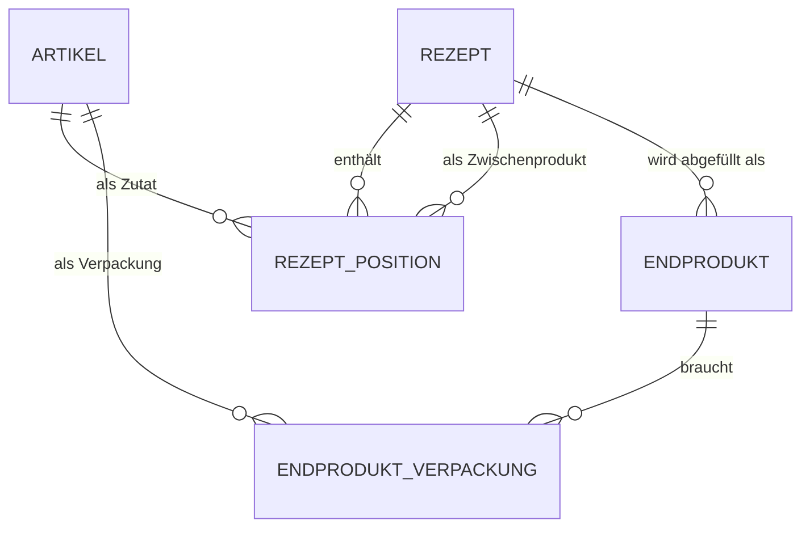

# Herstellkosten-Kalkulator

Lokales Tool zur groben Berechnung der **Herstellkosten pro Gebinde** (z. B. Sirup, Likör).
Einkaufspreise von Zutaten und Verpackungen werden auf g / ml / Stk heruntergebrochen und über
Rezepte und Endprodukte bis zum Preis pro Flasche hochgerechnet.

Einzelplatz-Anwendung für Windows und Linux, läuft nur auf dem eigenen PC im Browser (kein Login).

## Funktionen

| Seite | Inhalt |
|---|---|
| Übersicht | Herstellkosten aller Endprodukte, Kosten je Einheit aller Rezepte |
| Einkaufsartikel | Zutaten und Verpackungen mit Gebindegröße, Gebindepreis und Lieferant; Preis je kg / l / Stk |
| Rezepte | Zutaten oder Zwischenprodukte mit Mengen, Ausbeute, Live-Kalkulation, Kosten je Einheit (z. B. €/ml · €/cl · €/l), Duplizieren |
| Endprodukte | Rezept + Füllmenge (ml) + Verpackung = Herstellkosten je Gebinde |
| Einkaufsliste | Hochrechnung für eine gewünschte Anzahl: Bedarf, ganze Gebinde, Einkaufs- und Verbrauchskosten, herzustellende Chargen |
| Import / Export | Rezepte inkl. Zwischenprodukten und Artikeln als JSON weitergeben |

**Typisches Vorgehen:** 1. Einkaufsartikel anlegen → 2. Rezepte erfassen → 3. Endprodukte festlegen.

**Kostenumfang:** Nur Material (Zutaten und Verpackung). Nicht enthalten sind Arbeitszeit, Energie,
Alkoholsteuer, Marge, MwSt. und Verkaufspreis.

## Voraussetzungen

- Python **3.11 oder neuer**
- Linux (Debian/Ubuntu): zusätzlich das Paket `python3-venv`
  ```bash
  sudo apt install python3-venv
  ```

## Starten

```bash
python start.py
```

Unter Linux heißt der Befehl je nach Distribution `python3 start.py`.

Beim **ersten Start** legt `start.py` die virtuelle Umgebung `.venv` an und installiert die
Abhängigkeiten aus `requirements.txt`. Das dauert einmalig etwas. Danach öffnet sich das Tool
im Browser unter <http://localhost:8501>.

Beenden mit `Strg+C` im Terminal.

## Rechenregeln

### Einheiten

Umgerechnet wird nur innerhalb einer Gruppe. Passt die Einheit im Rezept nicht zur Einkaufseinheit
(z. B. Zucker in kg gekauft, im Rezept in ml), meldet das Tool einen Fehler statt falsch zu rechnen.

| Gruppe | Basiseinheit | Einheiten |
|---|---|---|
| Masse | g | g, kg |
| Volumen | ml | ml, cl, l |
| Stück | Stk | Stk |

### Formeln

$$
p_{\text{Artikel}} = \frac{\text{Gebindepreis}}{\text{Gebindegröße in Basiseinheit}}
\qquad
K_{\text{Charge}} = \sum_i \text{Menge}_i \cdot p_i
\qquad
p_{\text{Rezept}} = \frac{K_{\text{Charge}}}{\text{Ausbeute in Basiseinheit}}
$$

$$
K_{\text{Gebinde}} = \text{Füllmenge} \cdot p_{\text{Rezept}} + \sum_j \text{Anzahl}_j \cdot p_{\text{Verpackung},j}
$$

$p_i$ ist der Preis eines Einkaufsartikels oder eines Zwischenprodukts (rekursiv berechnet).

### Regeln

- **Ausbeute wird von Hand eingegeben**, weil sie durch Verdunstung, Schalen usw. selten der Summe der
  Zutaten entspricht. Die Summe der Zutatenmengen wird als Anhaltspunkt angezeigt.
- **Einheitenwechsel über Zwischenprodukte:** Die Ausbeute darf eine andere Einheit haben als die
  Zutaten, z. B. Orangen in Stk → Rezept „Orangensaft“ mit Ausbeute in ml → weiter in ml rechnen.
- **Ganze Artikel zählen:** Wird nur ein Teil eines Artikels genutzt (z. B. die Schale einer Orange),
  trägt das Rezept trotzdem die vollen Kosten, da der ganze Artikel gekauft werden muss.
- **Endprodukte werden immer in ml abgefüllt**, das Rezept braucht daher eine Ausbeute in ml/cl/l.
  Verpackungen müssen in Stk eingekauft werden.
- **Zirkelbezüge** (A enthält B, B enthält A) werden beim Speichern abgelehnt.
- **Kostenlose Zutaten** (z. B. Leitungswasser) als Artikel mit Preis 0 anlegen.
- **Jede Änderung wird geprüft:** Vor dem Speichern werden alle Rezepte und Endprodukte durchgerechnet.
  Würde etwas ungültig (z. B. Einheit eines verwendeten Artikels geändert), wird nicht gespeichert.
- **Löschen** ist nur möglich, wenn Artikel bzw. Rezept nirgends mehr verwendet wird.
- **Namen** sind eindeutig, Groß-/Kleinschreibung zählt dabei nicht.
- **Preise werden nie gespeichert**, sondern immer live berechnet. Preisänderungen wirken sofort überall.
- **Rundung:** Intern exakt (`Decimal`), gerundet wird nur in der Anzeige: Beträge auf 2 Stellen,
  Preise je Einheit mit so vielen Stellen, dass 2 gültige Ziffern sichtbar sind (max. 6, z. B. 0,0021 €/ml).
- **Einkaufsliste:** Gebinde werden auf ganze Gebinde aufgerundet.

### Beispielrechnung (Referenz für die Tests)

| Einkauf | Preis je Basiseinheit |
|---|---|
| Orangen 10 kg für 15,00 € | 0,0015 €/g |
| Zucker 1 kg für 1,20 € | 0,0012 €/g |
| Alkohol 96 % 1 l für 25,00 € | 0,025 €/ml |
| Wasser | 0 |
| Flasche / Verschluss / Etikett je 100 Stk für 60 / 10 / 15 € | 0,60 / 0,10 / 0,15 €/Stk |

- **Orangensirup** (Ausbeute 2 l): 2 kg Orangen + 1 kg Zucker + 1 l Wasser = 4,20 € → **2,10 €/l**
- **Orangenlikör** (Ausbeute 1 l): 0,3 l Alkohol + 0,6 l Sirup + 0,1 l Wasser = 8,76 € → **8,76 €/l**
- **Endprodukte** à 0,5 l inkl. 0,85 € Verpackung: Sirup **1,90 €**, Likör **5,23 €**
- **Stück → ml:** 20 Orangen für 8,00 €, 10 Stk ergeben 800 ml Saft → **5,00 €/l**

## Befehle für die Entwicklung

Alle Befehle im Projektordner ausführen. Sie nutzen das Python aus der `.venv`, die `start.py`
beim ersten Start anlegt.

| Zweck | Windows | Linux |
|---|---|---|
| Alle Tests | `.venv\Scripts\python.exe -m pytest -q` | `.venv/bin/python -m pytest -q` |
| Tests einer Datei | `.venv\Scripts\python.exe -m pytest tests\test_berechnung.py` | `.venv/bin/python -m pytest tests/test_berechnung.py` |
| Nur Fachlogik-Tests (schnell) | `.venv\Scripts\python.exe -m pytest -q --ignore-glob="tests/test_seite_*"` | `.venv/bin/python -m pytest -q --ignore-glob="tests/test_seite_*"` |
| Abhängigkeiten manuell installieren | `.venv\Scripts\python.exe -m pip install -r requirements.txt` | `.venv/bin/python -m pip install -r requirements.txt` |
| Streamlit ohne `start.py` | `.venv\Scripts\python.exe -m streamlit run app.py` | `.venv/bin/python -m streamlit run app.py` |

Hinweise:

- Ändert sich `requirements.txt`, installiert `start.py` beim nächsten Start automatisch neu.
- Für eine komplett frische Umgebung den Ordner `.venv` löschen und `python start.py` erneut ausführen.
- Nach Codeänderungen die App neu starten (`Strg+C`, dann `python start.py`). `start.py` schaltet das
  automatische Neuladen von Streamlit bewusst ab, weil halb neu geladene Module zu Fehlern führen.
- Neue Seiten in `pages/` müssen zusätzlich in `app.py` (`st.navigation`) eingetragen werden.

## Daten

- Alle Daten liegen in einer einzigen Datei: `daten/kalkulation.db` (SQLite).
- Sie wird beim ersten Zugriff automatisch angelegt.
- **Sichern:** Datei kopieren (während das Tool nicht läuft).
- **Zurücksetzen:** Datei löschen – beim nächsten Start wird eine leere Datenbank angelegt.
- Die Datei kann zwischen Windows und Linux ausgetauscht werden.
- **Rezepte weitergeben:** Seite „Import / Export“. Die JSON-Datei enthält die Rezepte samt
  Zwischenprodukten und benötigten Einkaufsartikeln. Beim Import werden vorhandene Namen
  (Groß-/Kleinschreibung egal) verwendet und nicht überschrieben; importiert wird ganz oder gar nicht.

## Technik

**Python + Streamlit + SQLite.** Streamlit liefert die Browser-Oberfläche ohne eigene Web-Entwicklung,
SQLite speichert alles in einer Datei. Verworfen wurden Excel (Zwischenprodukte und Einheitenprüfung
zu unübersichtlich), ein reines Kommandozeilen-Skript (unbequem) und eine eigene Web-App (zu aufwendig).

Grundsätze:

- Die Fachlogik in `kalkulation/` kennt Streamlit nicht und ist dadurch einzeln testbar.
- `start.py` nutzt nur die Python-Standardbibliothek, damit es vor der Installation läuft.
- Plattformunabhängig: Pfade nur über `pathlib`, Dateien immer mit `encoding="utf-8"`.
- Streamlit läuft nur auf `localhost`, ohne Nutzungsstatistik und ohne E-Mail-Abfrage beim ersten Start.

### Datenmodell



- `artikel`: Name, Kategorie (zutat/verpackung), Gebindemenge, -einheit, -preis, Lieferant, Notiz
- `rezept`: Name, Ausbeutemenge, -einheit, Notiz
- `rezept_position`: Menge, Einheit und **entweder** `artikel_id` **oder** `zwischenprodukt_id` (per `CHECK` abgesichert)
- `endprodukt`: Name, Rezept, `fuellmenge_ml`
- `endprodukt_verpackung`: Artikel und Anzahl je Gebinde
- Zahlen werden als Text gespeichert, damit sie exakt bleiben. Berechnete Preise werden nicht gespeichert.

## Projektstruktur

```
start.py            Startskript für Windows und Linux
app.py              Streamlit-Einstieg: Navigation (Seitenleiste)
oberflaeche.py      Gemeinsame Hilfen der Seiten (Datenbankzugriff, Meldungen, Tabellen)
pages/              Seiten, in app.py registriert
  0_Uebersicht.py   Startseite: Herstellkosten aller Endprodukte und Rezepte
  1_Einkaufsartikel.py
  2_Rezepte.py
  3_Endprodukte.py
  4_Einkaufsliste.py   Hochrechnung: Bedarf, Gebinde, Kosten, herzustellende Chargen
  5_Import_Export.py   Rezepte als JSON exportieren und importieren
kalkulation/        Fachlogik (unabhängig von der Oberfläche)
  einheiten.py      Einheiten, Gruppen, Umrechnung
  modelle.py        Datenklassen inkl. Eingabeprüfung
  berechnung.py     Kostenberechnung, Zirkelprüfung, Hochrechnung/Einkaufsliste
  datenbank.py      SQLite: Laden, Speichern, Löschen, Duplizieren, Import
  austausch.py      Exportformat (JSON) und Prüfung von Importdateien
  anzeige.py        Formatierung (Euro, Mengen, Preise je Einheit)
tests/              pytest-Tests (inkl. Oberflächentests mit Streamlit AppTest)
  conftest.py       Test-Datenbank und Beispieldaten für Oberflächentests
  seitenhilfe.py    Hilfen zum Starten und Bedienen der Seiten im Test
daten/              Datenbank (wird automatisch angelegt, nicht versioniert)
```

## Stand

| Meilenstein | Status |
|---|---|
| 1 Projektgerüst | erledigt |
| 2 Rechenkern | erledigt |
| 3 Datenbank | erledigt |
| 4 Seite Einkaufsartikel | erledigt |
| 5 Seite Rezepte | erledigt |
| 6 Seite Endprodukte | erledigt |
| 7 Übersicht | erledigt |
| 8 Echte Daten | erledigt |
| 9 Komfort: Rezepte duplizieren, Export/Import, Einkaufsliste mit Hochrechnung | erledigt |

### Offene Punkte / Ideen

- **Plattformtest unter Linux:** Tests und Erststart mit `python3 start.py` (ohne `.venv`) einmal unter
  Linux durchführen. Bisher nur unter Windows getestet.
- Export der Übersicht als CSV/Excel oder PDF
- Umrechnung Masse ↔ Volumen über eine Dichte (z. B. Zucker in ml)
